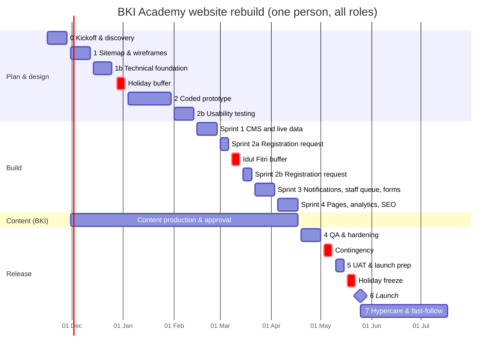

# BKI Academy — Website Rebuild Timeline

Version: 1.2 · 17 November 2026 · Status: proposed plan, not yet agreed

Companions: `PRD.md` (product behaviour, delivery sequence §10, acceptance criteria) and `design.md` (styling, colour, layout). This timeline turns PRD §10 into dated phases. Dates are estimates for planning and must be re-confirmed after Phase 0. Phase 0 progress is tracked in the Phase 0 Google Sheet (owners, decisions, URL inventory, content gaps).

## Planning assumptions

- **Team:** one person covers project lead, UI/UX design, full-stack development (Next.js + Payload), and QA. BKI business, content, brand, data/privacy, enquiry-handling, and launch owners are separate people available for weekly reviews, approvals, and test sessions.
- **One thing at a time:** design and build cannot run in parallel, so phases follow each other. Design is done mostly in code: low-fidelity wireframes first, then a coded prototype on staging built from design.md tokens. The coded prototype replaces separate high-fidelity design files and the component sheet in design.md §13.
- **Scope:** P0 launch requirements only (PRD §4). Instructors and Insights launch as a fast-follow after go-live, hidden from navigation and the sitemap until then (allowed by PRD §4). P1 items (English, comparisons, CRM/ERP integration) come after launch.
- **Source of truth:** Payload/PostgreSQL. If Odoo must stay the source for courses or sessions, add **5–7 weeks** to Build for the integration.
- **Content entry:** BKI editors enter courses and sessions in Payload from Build Sprint 1 onward. The developer builds import scripts only for bulk seed data.
- **Independent checks:** because the builder is also the tester, BKI staff run structured test passes during QA and UAT, and automated checks (Playwright, axe accessibility checks, Lighthouse) run in CI.
- **Holidays:** reduced capacity over Christmas/New Year; Ramadan (expected from about 8 February 2027); Idul Fitri (expected around 9–10 March 2027); Good Friday 26 March 2027; Ascension Day 6 May 2027; Idul Adha and Waisak (both expected in the second half of May 2027). Confirm all dates and cuti bersama against the official SKB calendar.
- **Biggest schedule risks:** one person with no backup, and approved content (fees, credentials, contacts, photos, Indonesian copy). Content work runs in parallel from week 3, owned by BKI.

## What changed

| Item | v1.0 (team of five) | v1.1 (one developer) | v1.2 (one person, all roles) |
|---|---|---|---|
| Design | Hi-fi design files, W3–W6 | Same | Wireframes, then a coded prototype |
| Design and build | In parallel | In parallel | One after the other |
| Usability testing | 4 – 15 Jan, design prototype | Same | 1 – 12 Feb, coded prototype |
| Build | 3 sprints | 5 sprints | 4 sprints, 15 Feb – 16 Apr |
| QA | Part-time QA | Part-time QA | Self-test, automated checks, BKI staff test passes |
| Contingency | None | None | One week (3 – 7 May) |
| Target launch | Tue 30 Mar 2027 | Tue 27 Apr 2027 | **Tue 25 May 2027** |

## Summary

| Phase | Weeks | Dates | Outcome / gate |
|---|---|---|---|
| 0. Kickoff & discovery | W1–W2 | 16 Nov – 27 Nov 2026 | Decisions log and URL inventory signed off |
| 1. Sitemap & wireframes | W3–W4 | 30 Nov – 11 Dec 2026 | Low-fidelity desktop/mobile wireframes for the six core templates |
| 1b. Technical foundation | W5–W6 | 14 Dec – 24 Dec 2026 | Repo, CI, staging, tokens, Payload schema draft |
| — Holiday buffer | W7 | 28 Dec 2026 – 1 Jan 2027 | Reduced capacity |
| 2. Coded prototype | W8–W11 | 4 Jan – 29 Jan 2027 | Component library and six core templates on staging, styled per design.md |
| 2b. Usability testing & approval | W12–W13 | 1 Feb – 12 Feb 2027 | 4 of 5 testers pass each core task; templates approved |
| 3. Build (4 sprints) | W14–W22 | 15 Feb – 16 Apr 2027 | All P0 launch pages, forms, admin, and SEO on staging |
| — Idul Fitri buffer | W17 | 8 – 12 Mar 2027 | No releases |
| C. Content production (parallel, BKI) | W3–W22 | 30 Nov 2026 – 16 Apr 2027 | All launch content approved and loaded on staging |
| 4. QA & hardening | W23–W24 | 19 – 30 Apr 2027 | AC-01 to AC-12 passing on staging |
| — Contingency | W25 | 3 – 7 May 2027 | Slipped work only; Ascension Day 6 May |
| 5. UAT & launch preparation | W26 | 10 – 14 May 2027 | Staff UAT, staging sign-off, backup, rollback plan, redirect map |
| — Holiday freeze | W27 | 17 – 21 May 2027 | No releases (expected Idul Adha and Waisak; confirm dates) |
| 6. Launch | W28 | Tue 25 May 2027 (target) | Production release via the authorised process |
| 7. Hypercare, fast-follow & baseline | W28–W35 | 25 May – 16 Jul 2027 | Stable operation; Instructors and Insights live; analytics baseline |

**Target launch: Tuesday 25 May 2027** (about 27 weeks from kickoff). Avoid launching on a Friday or just before a holiday.

## Phase details

### Phase 0 — Kickoff & discovery (W1–W2)

- Name BKI owners: business, technical (organisational IT approval), brand/content, data/privacy, enquiry handling, and launch owner.
- Resolve PRD §11 decisions that block design or build: request-only vs instant booking, fee/tax wording, Odoo/CRM role, hosting provider, email provider, portal destination, language scope, MICE relevance. Agree this solo plan (decision L-02).
- Inventory current site: published URLs, files, course IDs, portal routes, forms, English pages, external links.
- Audit existing course and session data; list what is missing or unverified. Course detail pages on the current site return 403, so request a course export from the Odoo backend.
- Ask the brand/content owner to collect official logos, font licence, and permission-cleared photos.
- Ask BKI to recruit 5 usability testers for 1–12 Feb now, so testing is not delayed.

**Gate:** signed decisions log, URL inventory, content gap list, and named owners.

### Phase 1 — Sitemap & wireframes (W3–W4)

- Sitemap and navigation per PRD §5.
- Low-fidelity desktop and mobile wireframes for homepage, catalogue, schedule, course detail, registration request flow, and corporate enquiry. Include long Indonesian course titles and multiline dates.
- One review with the brand and content owners.

**Gate:** wireframes reviewed; structure agreed.

### Phase 1b — Technical foundation (W5–W6)

- Scaffold Next.js + Payload + PostgreSQL; record exact versions in the README (PRD §8.2).
- pnpm lockfile, pinned Node.js, CI running lint, TypeScript, tests, and build.
- Development and staging environments on managed hosting with managed PostgreSQL and object storage. Production can be created in Phase 5.
- Implement design.md §11 tokens and the §12 Tailwind/shadcn mapping.
- Draft Payload collections from PRD §7, starting with Category, Course, and Session.

**Gate:** a deployed staging shell with tokens applied and CI green.

### Phase 2 — Coded prototype (W8–W11)

- Component library with all states from design.md §8, shown on a styleguide route on staging. This replaces the separate component sheet.
- The six core templates built at full visual quality on staging, fed by seed data from the Phase 0 course audit.
- Registration request flow with visibly labelled simulated submission (PRD §8.6); real persistence comes in Build.
- Brand and content owners review screenshots at 390 px and 1440 px.

**Gate:** prototype ready for testing; brand owner approves colour, type, and logo direction.

### Phase 2b — Usability testing & approval (W12–W13)

- Test the staging prototype with 5 representative users (individual professionals, HR/training staff, technical manager).
- Tasks: find a relevant session, find fees and prerequisites, submit a test request, find corporate training (PRD §3).
- Record completion, errors, and time; fix navigation and templates in the second week.

**Gate:** at least 4 of 5 testers complete each core task unaided; templates approved.

### Phase 3 — Build (W14–W22, four sprints)

| Sprint | Dates | Scope |
|---|---|---|
| 1 | 15 – 26 Feb | Payload roles, draft/publish, change history; catalogue, schedule, and course detail on live CMS data; filters and search in the URL. Editors start entering content. |
| 2 | 1 – 5 Mar and 15 – 19 Mar | Registration request: server validation, idempotent submission, persistence, reference number, closed-session rejection, failure states |
| 3 | 22 Mar – 2 Apr | Notification outbox and worker; staff enquiry queue; corporate enquiry form; Hubungi Kami. Good Friday 26 Mar. |
| 4 | 5 – 16 Apr | Tentang Kami, policy and error pages; analytics events; SEO metadata, sitemap, redirects. Instructors and Insights collections only (pages hidden). |

Ramadan overlaps Sprints 1–2; plan for shorter working days. Playwright tests for each critical journey are written in the sprint that builds it.

**Gate:** all P0 launch functionality on staging with real, not placeholder, content structure.

### Content track (W3–W22, parallel, owned by BKI)

- Write and approve Indonesian copy, course pages, categories, FAQs, and fee wording.
- Verify credentials (issuer, scope, evidence, review date) and instructor bios with photo consent.
- Enter verified content into staging through Payload; anything unconfirmed stays visibly labelled and does not go live.

**Gate:** AC-09, every contact, approval, fee, policy, date, and brand asset has a named approver.

### Phase 4 — QA & hardening (W23–W24)

- End-to-end tests: anonymous course access, filter persistence, successful submission, closed-session rejection, duplicate submissions, staff permissions.
- Accessibility checks: automated axe checks plus a manual keyboard, focus, labels, errors, reduced motion, and 320 px reflow pass.
- Responsive checks at 320, 390, 768, 1024, 1440 px.
- Performance lab tests on mobile; redirect and link checks; security review and form rate limits.
- Two BKI staff run a written test script on staging and log issues. No new features.

**Gate:** AC-01 to AC-12 passing on staging, or each exception accepted by its owner.

### Contingency (W25)

Reserved for work that slipped from Build or QA. If nothing slipped, start UAT preparation early. Ascension Day falls on Thu 6 May.

### Phase 5 — UAT & launch preparation (W26)

- Staff publish a session and process a test enquiry without developer help (AC-12).
- Production environment, final redirect map, backup, rollback plan, monitoring, and error reporting in place.
- Go/no-go meeting with all owners.

**Gate:** written staging sign-off and a named launch owner.

### Phase 6 — Launch (target Tue 25 May 2027)

- Release through the authorised process; run migrations with a backup first.
- Smoke-test core journeys, forms, notifications, and redirects in production.

### Phase 7 — Hypercare, fast-follow & baseline (W28–W35)

- Weeks 1–2: daily checks of errors, submissions, and notification delivery; fast fixes only.
- Weeks 3–6: build and release the Instructors and Insights pages once their content is approved (target 2 Jul 2027).
- Weeks 3–8: collect the analytics baseline (PRD §3), review enquiries with staff, and plan P1 items.

## Working alone

- **Weekly rhythm:** one fixed weekly review with BKI owners (decisions, approvals, demo of staging). Everything else is async in the Phase 0 sheet so the builder keeps long blocks of focus time.
- **No second reviewer:** every merge passes CI (lint, TypeScript, tests, build, accessibility checks), and each pull request gets an automated code review before merge.
- **Keep operations small:** managed hosting and managed PostgreSQL; Payload's admin for the staff queue instead of a custom back office; database search; no extra services (PRD §8.3).
- **No single point of failure:** the README covers setup, environment variables, deploy, migration, backup restore, and rollback. Hosting, database, email, and domain accounts belong to a BKI organisational account, not a personal one, and a second BKI person has admin access.
- **Protect build time:** content entry, copy changes, and data clean-up go to BKI editors in Payload. New requests wait for the next sprint.

## Scope cut order if the build slips

Cut from the top until the plan fits, and record each cut in the decisions log:

1. Schedule archive page (completed sessions).
2. Waitlist handling for full sessions (show Full with a contact route instead).
3. Brochure downloads (HTML content stays).
4. Corporate enquiry form becomes a structured contact form on Hubungi Kami.

The catalogue, schedule, course detail, and registration request are never cut.

## Schedule risks

| Risk | Effect | Mitigation |
|---|---|---|
| The one person is unavailable (illness, leave, other assignments) | All work stops; no backup | Runbook and organisational accounts; agree a contractor or BKI IT fallback in Phase 0; contingency week; scope cut order |
| Phase 0 decisions slip | Wireframes and foundation start late | Weekly decision review; default to PRD recommendations if no decision by end of W2 |
| Content and approvals late | Launch blocked by AC-09 | BKI owns content from W3; editors enter it from Sprint 1; Instructors/Insights already after launch |
| Testers not available in February | Phase 2b slips and pushes Build | Recruit in Phase 0; BKI staff who match the audiences can fill gaps |
| Odoo must stay source of truth | +5–7 weeks build | Decide in Phase 0 |
| Holiday capacity | Sprint slippage | Buffers in W7, W17, and W27; contingency in W25 |
| Usability test fails gate | Rework before Build | Second week of Phase 2b is for fixes; coded prototype is cheaper to change than to rebuild |
| Builder misses own bugs | Defects reach launch | Automated checks in CI; BKI staff test passes in QA and UAT |

## Change log

- 1.2 · 17 November 2026 — Re-planned for one person covering project lead, design, development, and QA. Design and build now run in sequence; design moves to wireframes plus a coded prototype; usability testing moves to February; four build sprints; contingency week and holiday freeze added. Target launch moved to Tue 25 May 2027.
- 1.1 · 16 November 2026 — Re-planned for one full-stack developer. Target launch Tue 27 Apr 2027.
- 1.0 · 16 November 2026 — Initial plan assuming two developers, a designer, a project lead, and part-time QA.
